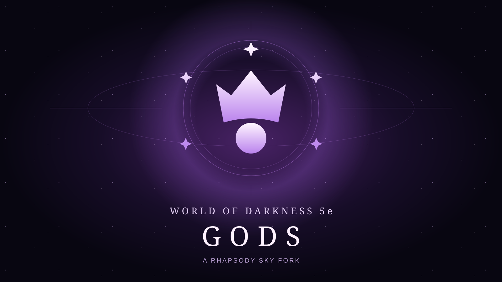

# World of Darkness 5e – Gods

[![Foundry Version Support]][System URL]
[![GNU GPL v3 License]][License URL]
[![ESLint]][ESLint URL]
[![Downloads]][Downloads URL]

This is Rhapsody-Sky's custom GPL fork of the [official World of Darkness 5e system](https://github.com/WoD5E-Developers/wod5e). It adds divine characters, cosmic violet dice and a fork-specific interface while retaining the upstream systems. Fork maintainer: [Rhapsody-Sky](https://github.com/Rhapsody-Sky). Original system: Veilza and the WoD5E Developers.

The package ID is **`wod5e-gods`**, not `wod5e`. Install using the [fork manifest](https://github.com/Rhapsody-Sky/wod5e/releases/latest/download/system.json); updates follow the fork's releases. Existing `wod5e` worlds require the backed-up, deliberate [migration](docs/FORK-MIGRATION.md), not a folder rename. Release `5.3.28-gods.1` is based on the official `5.3.28` system.

See the [fork changelog](https://github.com/Rhapsody-Sky/wod5e/releases) and the [upstream system documentation](https://wod5e-developers.github.io/).

Current supported systems include:

* Vampire the Masquerade, 5th Edition
* Hunter the Reckoning, 5th Edition
* Werewolf the Apocalypse, 5th Edition
* Gods (custom fork)

## Dice

To roll the splat-unique dice, replace the usual roll formula like so:

* To roll Vampire dice, roll `1dv`. To roll Hunger dice, roll `1dg`.
* To roll Hunter dice, roll `1dh`. To roll Desperation dice, roll `1ds`.
* To roll Werewolf dice, roll `1dw`. To roll Rage dice, roll `1dr`.
* To roll God dice, roll `1do`.

Replace the 1s with however many you want to roll for each type, and let the dice roll! We also have compatibility with the [Dice So Nice!](https://foundryvtt.com/packages/dice-so-nice/) module, so whenever you roll splat dice you'll get the World of Darkness 5th edition symbols on the 3D dice faces.

## Feedback

Bugs and feature requests for this fork belong on the [fork issue tracker](https://github.com/Rhapsody-Sky/wod5e/issues). Check the official repository for base-system issues.

The official Foundry #wod community and upstream maintainers support the original system, not this fork's custom additions.

Please check the issues list before suggesting new features.

## Contributors & Contributing

The lead system developer is [Veilza](https://github.com/Veilza), and the original creator of the system is [Rayji96](https://github.com/Rayji96).

There's lots of other people who contribute to the system, too, and you can find the full list of them down [here](https://github.com/WoD5E-Developers/.github/blob/main/contributors.md)!

This fork is developed separately and does not submit its custom work upstream. The **official** WOD5E repository carries a "No AI" label under Foundry's [AI Content Policy]; do not submit this fork's AI-assisted code there. Official changes are integrated into this fork while preserving upstream attribution and the GPL license.

If you'd like to help contribute localization updates, you can either open up an issue with the "Localization" issue type, or you can do a pull request with updates as needed.

## Dark Pack

[![Dark Pack]][Dark Pack URL]

Licensed WoD 5e materials will not be provided as this system is provided for public usage, for free. We have made every effort to keep the Dark Pack guidelines as posted at [Dark Pack Agreement].

# System License

World of Darkness 5e System for Foundry VTT
Copyright (C) 2024, World of Darkness 5e Developers

This program is free software: you can redistribute it and/or modify
it under the terms of the GNU General Public License as published by
the Free Software Foundation, either version 3 of the License, or
(at your option) any later version.

This program is distributed in the hope that it will be useful,
but WITHOUT ANY WARRANTY; without even the implied warranty of
MERCHANTABILITY or FITNESS FOR A PARTICULAR PURPOSE.  See the
GNU General Public License for more details.

You should have received a copy of the GNU General Public License
along with this program.  If not, see <https://www.gnu.org/licenses/>.

[Foundry Version Support]: https://img.shields.io/endpoint?url=https%3A%2F%2Ffoundryshields.com%2Fversion%3Fstyle%3Dplastic%26url%3Dhttps%3A%2F%2Fgithub.com%2FRhapsody-Sky%2Fwod5e%2Freleases%2Flatest%2Fdownload%2Fsystem.json
[System URL]: https://github.com/Rhapsody-Sky/wod5e/releases
[AI Content Policy]: https://foundryvtt.com/article/ai-policy/

[GNU GPL v3 License]: https://img.shields.io/badge/License-GNU_GPL_v3-green
[License URL]: ./LICENSE.md

[ESLint]: https://github.com/Rhapsody-Sky/wod5e/actions/workflows/test.yml/badge.svg
[ESLint URL]: https://github.com/Rhapsody-Sky/wod5e/actions/workflows/test.yml

[Downloads]: https://img.shields.io/github/downloads/Rhapsody-Sky/wod5e/wod5e-gods.zip
[Downloads URL]: https://github.com/Rhapsody-Sky/wod5e/releases

[Dark Pack]: ./assets/github/darkpack_logo2.png
[Dark Pack URL]: https://www.paradoxinteractive.com/games/world-of-darkness/community/dark-pack-agreement
[Dark Pack Agreement]: https://www.paradoxinteractive.com/games/world-of-darkness/community/dark-pack-agreement

